<a href="https://t.me/yasavok"><picture><source media="(max-width: 767px)" srcset="assets/hero-m.svg"><source media="(prefers-color-scheme: dark)" srcset="assets/hero-dark.svg"></picture></a>
<a href="https://github.com/yasavok?tab=repositories"><picture><source media="(max-width: 767px)" srcset="assets/stack-m.svg"><source media="(prefers-color-scheme: dark)" srcset="assets/stack-dark.svg"></picture></a>

<a href="https://github.com/yasavok/Savix"><picture><source media="(max-width: 767px)" srcset="assets/savix-m.svg"><source media="(prefers-color-scheme: dark)" srcset="assets/savix-dark.svg"></picture></a>
<a href="https://github.com/yasavok/PlayerAnalytics"><picture><source media="(max-width: 767px)" srcset="assets/player-analytics-m.svg"><source media="(prefers-color-scheme: dark)" srcset="assets/player-analytics-dark.svg"></picture></a>
<a href="https://github.com/yasavok/exportplantuml"><picture><source media="(max-width: 767px)" srcset="assets/exportplantuml-m.svg"><source media="(prefers-color-scheme: dark)" srcset="assets/exportplantuml-dark.svg"></picture></a>
<a href="https://github.com/yasavok/KlavoBot"><picture><source media="(max-width: 767px)" srcset="assets/klavobot-m.svg"><source media="(prefers-color-scheme: dark)" srcset="assets/klavobot-dark.svg"></picture></a>
<a href="https://github.com/yasavok/Unity-DestroyObject-CameraZone"><picture><source media="(max-width: 767px)" srcset="assets/camera-zone-m.svg"><source media="(prefers-color-scheme: dark)" srcset="assets/camera-zone-dark.svg"></picture></a>

<a href="https://t.me/yasavok"><picture><source media="(max-width: 767px)" srcset="assets/telegram-m.svg"><source media="(prefers-color-scheme: dark)" srcset="assets/telegram-dark.svg"></picture></a>
